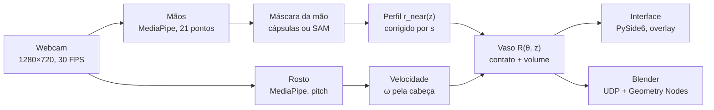

# PotteryCV: Modelagem de cerâmica virtual guiada por visão computacional

Visão Computacional - PPGTI3007<br/>
Samuel Soares Pereira Costa

## 1. Introdução

Este trabalho apresenta o protótipo de uma aplicação que simula virtualmente um ambiente de modelagem de cerâmica, constituído por um torno e pela matéria-prima (argila). O sistema é controlado por visão computacional em tempo real, utilizando uma webcam para capturar quadros de vídeo e rastrear a posição e o ângulo das mãos e da cabeça do usuário, permitindo a modelagem interativa de um vaso tridimensional e sua visualização, também em tempo real, através do software Blender, na versão 5.2.

Assim, o torno virtual permite experimentar formas sem o custo de matéria-prima e sem desperdício de material, simulando tanto a modelagem da argila quanto o pedal que controla a velocidade da roda. Quanto à técnica, o trabalho se situa na estimativa de poses: são detectados 21 landmarks por mão e a orientação da cabeça é obtida a partir da malha facial. A silhueta da mão é então segmentada a partir desses landmarks, com máscaras simples, MobileSAM ou SAM 3.

## 2. Desenvolvimento e técnicas utilizadas

Cada quadro da webcam passa por um pipeline que vai do pixel até a malha no Blender. As seções abaixo seguem essa ordem.



A mão define a forma e a cabeça define a velocidade da roda; os dois ramos se combinam no modelo do vaso, que vai para a interface e para o Blender.

### 2.1. Pose da cabeça

O MediaPipe Face Landmarker fornece a matriz de transformação facial, convertida em ângulos de Euler. Só o pitch é usado, e sua variação em relação à posição neutra controla a roda: olhar para baixo além de 8° acelera a roda, olhar para cima além de 4° a freia, e a faixa neutra mantém a velocidade.

### 2.2. Pose da mão

O MediaPipe Hand Landmarker devolve 21 pontos por mão. Eles passam por um filtro One Euro, que suaviza quando a mão está parada e tem pouco atraso quando ela se movimenta rápido. A cada mão é atribuída a uma borda do vaso (esquerda ou direita da tela) de forma persistente entre quadros.

### 2.3. Segmentação da mão

Os landmarks ficam no centro dos dedos e estimam apenas a pose, então não definem a borda real da mão. Sendo assim, foram implementados três extratores de máscara para testar a segmentação da área:

- **Landmarks:** a mão desenhada como cápsulas ao longo de cada osso, com raio proporcional ao tamanho da mão. É instantâneo, mas aproximado, especialmente com relação às pontas dos dedos.
- **MobileSAM:** o modelo recebe como prompt a caixa da mão e o centro da palma, ambos tirados dos landmarks.
- **SAM 3:** recebe o mesmo prompt do MobileSAM num modelo bem maior (com 473M de parâmetros).

Os modelos SAM rodam num processo separado na GPU, de forma assíncrona. Enquanto uma inferência não volta, a última máscara é propagada para o quadro atual por uma transformação de similaridade estimada entre os landmarks antigos e os atuais. Assim o pipeline não espera o segmentador, mesmo ele levando ~0,5 s por máscara.

A partir da máscara é extraído o perfil da ferramenta: para cada altura z do vaso, o pixel da mão mais próximo do eixo, convertido em raio `r_near(z)`. O perfil não é convexo, então cada dedo deixa sua própria marca.

### 2.4. Calibração

A calibração tem duas etapas guiadas pela interface: na primeira, a posição neutra da cabeça define o pitch de referência (ângulo 0). Na segunda, as mãos de lado, na largura desejada, definem o raio inicial do vaso, o eixo de simetria, e a escala k em metros por pixel:

$$k = \frac{L_{real}}{L_{ref}}$$

onde `L_real` = 9,5 cm é a distância real média do pulso à base do dedo médio e `L_ref` é essa distância em pixels na calibração.

Uma câmera monocular não mede distância diretamente, mas o tamanho aparente da mão é inversamente proporcional a ela. A razão `s = L / L_ref` indica o quanto a mão está mais perto (s > 1) ou mais longe (s < 1) do que na calibração. As coordenadas são corrigidas dividindo o deslocamento por s em torno de um ponto de ancoragem a:

$$u' = a_u + \frac{u - a_u}{s}, \qquad x = k\,(u' - u_{eixo}), \qquad z = k\,(v_{base} - v')$$

A âncora é o ponto de contato da própria mão com o vaso. Assim o contato fica onde o usuário o vê na tela, e só a espessura dos dedos é corrigida.

### 2.5. Modelo do vaso

O vaso é um mapa de raios R(θ, z) de 96 colunas por 64 níveis, cada coluna com sua própria altura `H_c`. A cada quadro a roda gira Δφ = ω·Δt, e uma varredura de arco determina quais colunas passaram sob cada mão. Cada coluna é modelada exatamente uma vez por passagem, a qualquer velocidade.

O contato é uma máquina de estados com histerese: a mão só engata vindo de fora (ou de cima, no caso do topo) e só solta depois de 3 quadros afastada mais de 1,5 cm. Ao empurrar, o raio se aproxima do perfil da mão com plasticidade α = 0,6, e a deformação é espalhada aos vizinhos por um filtro gaussiano.

Para simular a física e conservar o volume, o barro deslocado tem que ir para algum lugar. O volume de cada coluna é

$$V_c = \pi \cdot H_c \cdot \overline{R^2}$$

Apertar dos lados reduz a média de R² e faz a coluna subir. O parâmetro `side_gain`, entre 0 e 1, ajusta a conservação de volume: a cada transformação lateral, parte do volume deslocado vira altura. Com 1, todo o volume é conservado, mas o vaso cresce rápido demais para ser controlado; por isso o padrão é 0,4. Esmagar o topo reduz `H_c` e devolve o volume como raio: metade distribuída por igual e metade numa barriga com pico a 1/3 da altura, mantendo `V_c` exato. O usuário pode desfazer até 10 toques (Ctrl+Z).

### 2.6. Interface e Blender

A interface, construída com PySide6, mostra a câmera com o perfil do vaso sobreposto, o medidor de inclinação da cabeça (e velocidade do torno), os controles gerais da aplicação (que incluem botões para realizar a calibração guiada com instruções, resetar a forma do vaso, desfazer a última modificação e gravar a sessão), além de um painel de depuração com FPS e latência. O estado de modelagem do vaso é enviado através do protocolo UDP num único datagrama de ~12 KB, composto principalmente pelo mapa de raios (96 × 64 valores de 16 bits), além de um cabeçalho com a altura, o ângulo da roda, a umidade e as marcas de tempo.

Além da visualização 2D do perfil em uma rotação específica, foi utilizado o Blender, software livre de modelagem 3D, para construir uma visualização tridimensional. O Blender é escrito principalmente em C e C++, mas embute um interpretador Python com uma API própria (bpy), que permite automatizá-lo por scripts. Assim, um script dentro do Blender recebe o pacote UDP enviado pela interface e atualiza os atributos que modelam proceduralmente a malha 3D, de modo que ela acompanhe as transformações feitas pelo usuário. No Blender, o material da argila também é capaz de ler valores para variar a aparência do material, de modo que a interação afeta não só a forma, mas também o aspecto do vaso.

Para controlar a malha de forma dinâmica e procedural, foi usado o Geometry Nodes, sistema nativo do Blender baseado em nós, introduzido em 2021, na versão 2.92. Nele foi montada uma árvore de nós que recebe os parâmetros enviados via UDP e altera matematicamente o modelo da argila. O script receptor também devolve um ECHO com o instante em que aplicou o quadro, o que permite medir a latência de ponta a ponta.

O Blender possui dois motores principais de renderização final: o Cycles e o EEVEE, os quais operam com arquiteturas gráficas distintas. O Cycles baseia-se em rastreamento de caminhos (path tracing), simulando fisicamente a trajetória da luz para obter fotorrealismo, o que exige maior processamento. Em contrapartida, o EEVEE emprega rasterização em tempo real para aproximar iluminação e reflexos de forma quase instantânea, priorizando a velocidade de execução em detrimento da precisão física e do realismo.

Atualmente é possível acompanhar as modificações do modelo através de qualquer um dos dois renderizadores, e também pela viewport, com o renderizador Workbench (que exibe apenas formas simples). Além disso, a interface conta com uma seção ativável que permite ver as alterações do software de modelagem diretamente na interface desenvolvida, utilizando uma imagem exportada da câmera virtual do Blender. Porém, na versão atual, essa opção possui baixo framerate de atualização e ainda não é possível utilizá-la em conjunto com o renderizador Cycles.

## 3. Resultados e conclusões

O sistema foi desenvolvido e testado num PC com GPU RTX 3060, variando os três extratores; a escolha entre eles considera a fidelidade do contorno e o custo.

### 3.1. Contorno da mão

| Extrator | Tempo por inferência | VRAM | Contorno na prática |
|---|---|---|---|
| Landmarks (cápsulas) | < 1 ms | não usa GPU | estável, mas arredonda os dedos |
| MobileSAM | ~40 ms | não medida | muito impreciso, bordas serrilhadas |
| SAM 3 (fp16) | ~460–500 ms | 2,4 GB | muito impreciso, bordas serrilhadas, atrasa no movimento |

### 3.2. Desempenho e latência

| Medida | Mediana | p95 |
|---|---|---|
| FPS do pipeline (landmarks) | 15,2 (média) | não se aplica |
| Tempo de processamento por quadro | 57 ms | 73 ms |
| Captura → processado | 75 ms | 101 ms |
| Captura → aplicado no Blender | 90 ms | 121 ms |

Medido numa sessão de ~73 s (1107 quadros) no PC com a RTX 3060, com o extrator landmarks e o Blender recebendo. Do tempo de processamento, a detecção das mãos pelo MediaPipe leva a maior parte (mediana de 33 ms), seguida do rosto (9 ms), da máscara (3,5 ms) e da simulação do vaso (0,5 ms). Entre o envio e a aplicação no Blender passam ~14 ms, em boa parte espera do receptor, que verifica o socket 60 vezes por segundo (a cada ~17 ms); aplicar o estado na malha leva menos de 1 ms. Na captura, o backend Media Foundation do OpenCV entregou 31 FPS em 720p, contra 8 FPS do DirectShow.

### 3.3. Análise crítica

Os landmarks bastam para modelar e foram adotados como extrator padrão: são instantâneos e estáveis, e o tempo real é o requisito principal do sistema. A desvantagem é arredondar os dedos. Os dois modelos SAM tiveram resultado muito pior que o esperado: tanto o MobileSAM quanto o SAM 3 produziram contornos extremamente imprecisos, com bordas muito serrilhadas, que deixam marcas irregulares no vaso. No SAM 3 isso se soma ao atraso: com ~2 máscaras por segundo, a máscara propagada fica para trás em movimentos rápidos. Assim, nenhum dos dois superou as cápsulas dos landmarks, nem em fidelidade do contorno, nem em custo. Também foi testado o RF-DETR, apontado no LibreYOLO como o melhor modelo para segmentação, o qual foi descartado nessa versão, pois detecta pessoas inteiras, sendo incapaz de segmentar apenas as mãos, processo que exigiria um fine-tuning.

### 3.4. Conclusões e limitações

O protótipo se mostrou funcional ao possibilitar a execução da ideia de modelagem de um vaso 3D em tempo real através do uso de uma webcam, combinando estimativa de pose e segmentação de imagem. Os landmarks garantem a resposta imediata e foram o modo adotado; os modelos SAM, executados de forma assíncrona com propagação, não travam o pipeline, mas produziram contornos imprecisos e serrilhados, sem ganho sobre as cápsulas no uso interativo.

Limitações:

- **Baixo número de testadores:** porém o sistema já implementa a calibração para que outro usuário possa recalibrar.
- **Profundidade aproximada:** a escala vem do tamanho da mão, então girar a mão muda a estimativa tanto quanto aproximá-la.
- **Iluminação e fundo:** o rastreamento piora com pouca luz e com fundos parecidos com a pele.
- **Interação limitada:** a mão só empurra, não há puxar barro para cima nem modelar por dentro.
- **Desempenho:** no Windows o MediaPipe roda apenas no processador, e a detecção das mãos (~33 ms) limita o pipeline a ~15 FPS, mesmo com GPU disponível.

Como trabalhos futuros, pretende-se (i) trabalhar a questão da profundidade das mãos, para não depender do tamanho da mão como escala; (ii) incluir gestos de puxar o barro para cima, hoje não suportados; (iii) fazer o fine-tuning do RF-DETR com imagens de mãos, para obter um segmentador que recorte a mão com precisão; e (iv) realizar um estudo com mais participantes, para avaliar a calibração e a usabilidade prática.

## Referências

- BLENDER FOUNDATION. *Blender 5.2 — Geometry Nodes*. Software. https://www.blender.org
- BLENDER FOUNDATION. *Blender Manual: render engines*. Disponível em: https://docs.blender.org/manual/en/latest/render/introduction.html. Acesso em: 25 nov. 2026.
- BLENDER FOUNDATION. *Blender Python API: API overview*. Disponível em: https://docs.blender.org/api/current/info_overview.html. Acesso em: 25 nov. 2026.
- BRADSKI, G. The OpenCV Library. *Dr. Dobb's Journal of Software Tools*, 2000.
- CARION, N. et al. *SAM 3: Segment Anything with Concepts*. Meta AI, 2025.
- CASIEZ, G.; ROUSSEL, N.; VOGEL, D. 1€ Filter: A Simple Speed-based Low-pass Filter for Noisy Input in Interactive Systems. *CHI*, 2012.
- HARTLEY, R.; ZISSERMAN, A. *Multiple View Geometry in Computer Vision*. 2. ed. Cambridge University Press, 2004.
- JOCHER, G. et al. *Ultralytics*. Software. https://github.com/ultralytics/ultralytics
- KARTYNNIK, Y. et al. Real-time Facial Surface Geometry from Monocular Video on Mobile GPUs. arXiv:1907.06724, 2019.
- KIRILLOV, A. et al. *Segment Anything*. ICCV, 2023. arXiv:2304.02643.
- QT COMPANY, The. *Qt for Python (PySide6)*. Software.
- ZHANG, C. et al. Faster Segment Anything: Towards Lightweight SAM for Mobile Applications (MobileSAM). arXiv:2306.14289, 2023.
- ZHANG, F. et al. MediaPipe Hands: On-device Real-time Hand Tracking. arXiv:2006.10214, 2020.


---

## Como rodar

### Instalação (Windows)

**Jeito rápido (portátil):** dois cliques em `rodar.bat`. Na primeira vez (com internet) ele baixa um Python portátil para `python\` (via [uv](https://docs.astral.sh/uv/), sem admin), instala as bibliotecas nele e baixa os modelos do MediaPipe. Depois a pasta inteira (~1,2 GB) roda em qualquer Windows 64 bits **sem instalar nada e sem internet**: copie a pasta toda (pendrive, Drive) e dê dois cliques no `rodar.bat`. Se o `requirements.txt` mudar, ele reinstala sozinho (aí precisa de internet).

Ou na mão:

Python 3.12 ou mais novo. No terminal (`cmd`), dentro da pasta do projeto:

```
python -m venv .venv
.venv\Scripts\activate
python -m pip install --upgrade pip
pip install -r requirements.txt
```

- `python -m venv .venv` cria um Python só do projeto (uma vez só).
- `.venv\Scripts\activate` liga esse Python: aparece `(.venv)` no começo da linha. **Rode toda vez que abrir um terminal novo**, senão cai no Python do sistema, sem as bibliotecas.
- No PowerShell, se o `activate` reclamar de "execução de scripts desabilitada": use o `cmd` ou rode uma vez `Set-ExecutionPolicy -Scope CurrentUser RemoteSigned`.

**Modelos do MediaPipe** (a pasta `models/` não vai para o repositório): baixe para `models/`
- [hand_landmarker.task](https://storage.googleapis.com/mediapipe-models/hand_landmarker/hand_landmarker/float16/latest/hand_landmarker.task)
- [face_landmarker.task](https://storage.googleapis.com/mediapipe-models/face_landmarker/face_landmarker/float16/latest/face_landmarker.task)

**Opcional, extratores SAM (só GPU NVIDIA):** `pip install torch torchvision --index-url https://download.pytorch.org/whl/cu130` e `pip install ultralytics`. Pesos `mobile_sam.pt` / `sam3.pt` em `models/`. Sem NVIDIA, use só o extrator `landmarks` (o padrão), que roda no processador.

### Rodar

Com o `.venv` ativado:

```
python main.py                       # webcam + interface
python main.py --viewer              # só o preview, via UDP
python tools\synthetic_sender.py     # vaso falso -> Blender (:9000) e viewer (:9002)
python -m pytest -q                  # testes
```

Se abrir e fechar na hora, rode pelo terminal para ver o erro. Câmera não abre: troque `backend` (`msmf`, `dshow`, `any`) ou `index` no `config.toml`.

### Uso

1. **Calibrar** [C]. Cada etapa mostra a instrução e espera **Continuar** [Espaço]; depois uma máscara aparece em volta do rosto/mãos, onde estiverem, e enche enquanto você fica parado:
   - 1/2: cabeça relaxada olhando para a tela;
   - 2/2: mãos de lado, dedos para cima, na **largura do vaso**. Define a escala, o eixo (meio das mãos) e o raio inicial. A base fica a 90% da altura da imagem.

   O perfil fica salvo em `calibration.json`.
2. **Modelar**:
   - Encoste a mão na silhueta laranja, por fora: os dedos deixam marca, o vaso afina e sobe (slider "subida ao apertar dos lados").
   - Empurre o topo de cima para baixo: o vaso achata e engorda.
   - Esmagou abaixo de 20% da altura inicial: reinicia após 3 s.
   - **Desfazer** [Ctrl+Z]: volta até 10 toques (o reset também).
   - **Debug** [D]: landmarks numerados e medidor da inclinação da cabeça.
3. **Velocidade pela cabeça**: um pouco para cima, freia; para baixo, acelera; neutra, mantém. Invertido: `pitch_sign = -1` no `config.toml`. Máximo em `[speed] max_rpm`.
4. **Gravar sessão**: salva em `data/sessions/<data>/` o vídeo e os CSVs de quadros, mãos e latência. Revise com `main.py --replay <pasta>`.

O mapa desenrolado (embaixo da câmera) mostra o raio do vaso em cada ângulo (horizontal) e altura (vertical); as linhas Left Hand / Right Hand marcam onde cada mão está tocando.

### Blender

Abra `blender/Pottery.blend`, no Text Editor abra `blender/pottery_receiver.py` e rode uma vez. Isso liga o receptor e cria o painel **Pottery** na barra lateral do 3D Viewport (tecla N), com o botão Ligar/Desligar e a vista da câmera a cada N estados. Detalhes em [specs/blender-guide.md](specs/blender-guide.md).

- **Vista do Blender** (caixinha na interface): mostra a imagem da câmera do Blender no painel da direita. Mais rápido com o viewport em Solid ou Material Preview.
- **Umidade**: o objeto recebe `wetness` (0..1), que sobe ao tocar e seca com o tempo (`wet_rise_s`, `wet_dry_s` em `[vase]`). No material, use o nó Attribute (Type = Object, Name = `wetness`).

### Avaliação

`tools\annotate.py <sessão>` para anotar máscaras; depois `tools\evaluate.py {fps|contour|jitter|depth|latency} <sessões>`.
